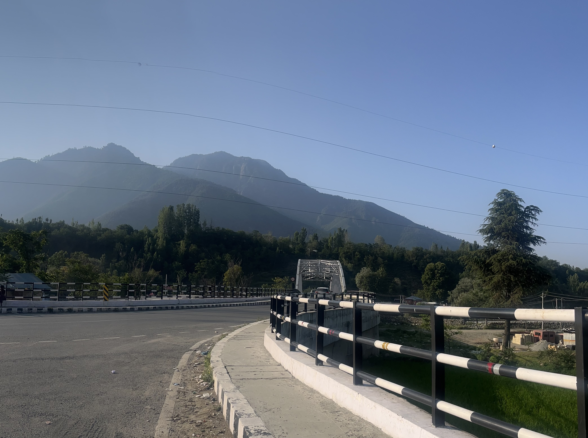
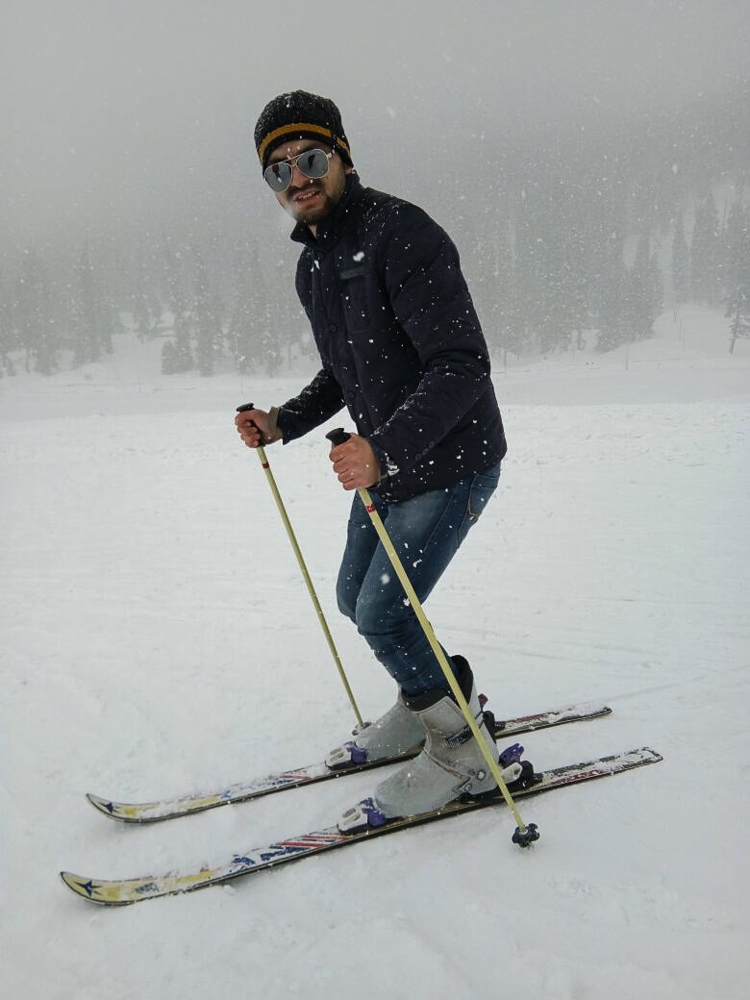
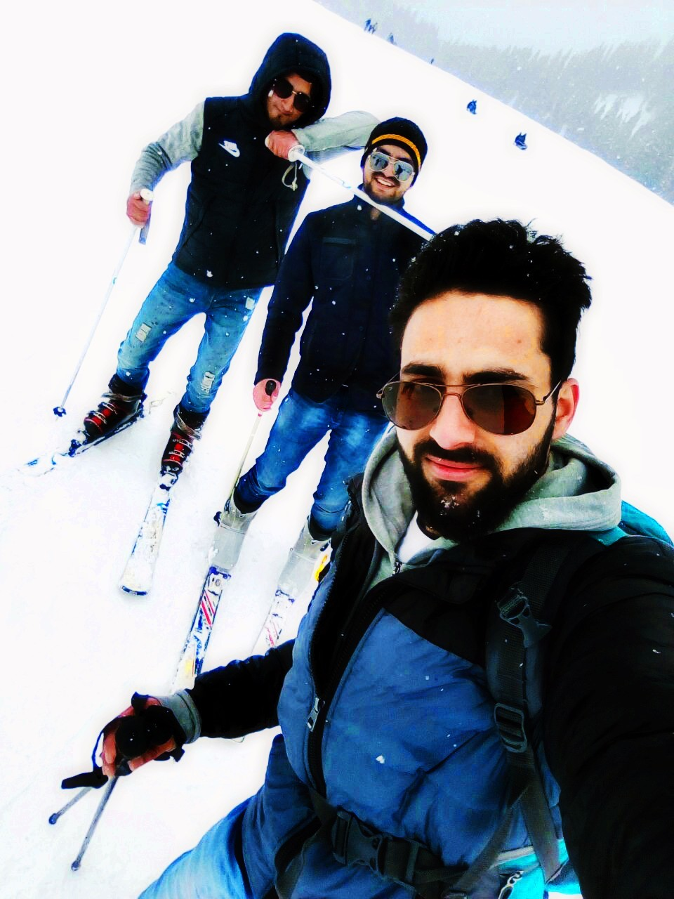

# Beyond the Desk

## June 2026: Hill Climbing in the Himalayas – Astanmarg, Srinagar, Kashmir, India (2,230m ASL)

## July 2026: 5:15 AM: Outrunning the Heat for 80 Kilometres

## January 2018: Gulmarg Skiing Base level ~ 2700m ASL

